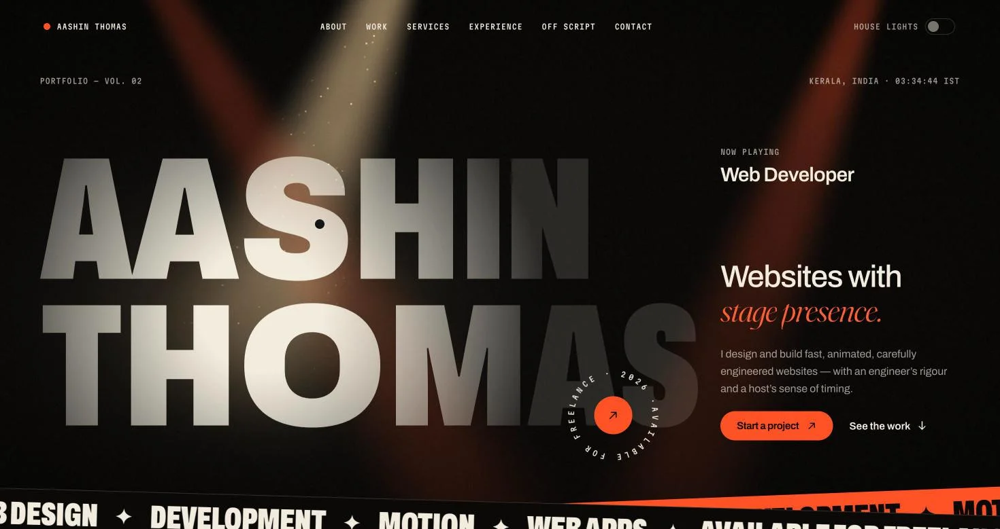

# Aashin Thomas — portfolio

The source for [aashin10.github.io](https://aashin10.github.io/): a single-page portfolio built around one
idea, *websites with stage presence*. A dark stage, a follow-spot that tracks the pointer, and a name that
widens and lights up wherever the beam lands.



## Stack

| | |
|---|---|
| Build | Vite 8, TypeScript |
| UI | React 19, Tailwind CSS 4 |
| Motion | [Motion](https://motion.dev) for React, [Lenis](https://lenis.darkroom.engineering) smooth scroll, one hand-written WebGL shader |
| Type | Archivo (width + weight axes), Fraunces italic, Martian Mono — self-hosted via Fontsource |

No UI kit and no 3D engine: the spotlight is a single fragment shader, and the project visuals are plain
React components.

## Run it

```bash
npm install
npm run dev        # http://localhost:5173
npm run check      # type-check, lint and production build
npm run preview    # serve the production build locally
```

Needs Node 20.19+ or 22.12+.

## Change the content

Every word on the site lives in [`src/content/site.ts`](src/content/site.ts) — hero copy, projects,
services, experience, certifications, contact details. Edit that file; the components only decide how it
moves.

**Add a project.** Append to `projects` in `site.ts`. Each project picks one of the live visuals
(`schedule`, `kanban`, `phone`, `typewriter`) and a card colour (`surface-dark`, `surface-paper`,
`surface-ember`). To give a project its own visual, add a component in `src/components/visuals/` and
register it in `VISUALS` in `src/components/sections/Work.tsx`.

**Add a photo.** Put the original in `media/originals/`, add a line to `SOURCES` in
[`scripts/optimize-images.mjs`](scripts/optimize-images.mjs), then:

```bash
npm run images
```

That writes responsive WebP files and a size manifest to `src/assets/img/`. Reference the image by name
with `<Picture name="…" />`.

**Contact form.** Posts to the Getform endpoint in `contact.endpoint`. Swap the URL to change where
messages go.

## Layout

```
src/
  content/site.ts        all copy and data
  styles/globals.css     design tokens, surfaces, type utilities
  providers/             theme (house lights), smooth scroll, curtain state
  components/
    core/                cursor, magnetic, split text, marquee, buttons, picture …
    layout/              preloader, nav, theme toggle, footer
    sections/            hero, about, work, services, experience, off script, stack, contact
    visuals/             WebGL spotlight + the four live project visuals
scripts/optimize-images.mjs
media/originals/         full-size source photos (not shipped)
```

Design decisions — palette, type, the motion inventory and why — are in [DESIGN.md](DESIGN.md).

## Deploying

GitHub Pages serves this site from the `gh-pages` branch. `npm run build` writes the static site to
`dist/`; publishing means putting the contents of `dist/` on `gh-pages`.

The workflow in `.github/workflows/publish.yml` only triggers on a branch named `master` (and manual
dispatch) and pushes to a branch named `build`, so merging to `main` does **not** deploy by itself.

## Accessibility and performance

- Honours `prefers-reduced-motion`: no smooth scroll, no parallax or pinning, tickers and loops stand
  still, the preloader is skipped and the hero renders a single lit frame.
- Keyboard: skip link, visible focus, Escape closes the menu, and the page behind the open menu is inert.
- Text colours meet WCAG AA against every surface.
- Scroll-linked effects run on transforms and opacity; the shader renders at reduced resolution and
  pauses when the hero is off screen.

## Credits

Fonts are licensed under the SIL Open Font License. Built with React, Motion and WebGL.
